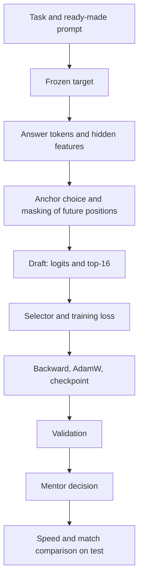

# End-to-end pipeline

## Stage by stage

1. Capture. The target reads the prompt and generates up to $G \le 320$ tokens.
   Its token IDs become labels, its hidden states become inputs. Nothing
   downstream can change what was captured.
2. Anchor and mask. One known token of the answer becomes the anchor. The draft
   gets that anchor followed by masked positions, plus the target features from
   before the anchor.
3. Draft forward. Six decoder layers produce hidden states for the block, and the
   frozen output head turns them into logits.
4. Two losses. Full-vocabulary cross-entropy trains the ordering over all $V$
   tokens. The selector loss trains the ordering inside the top-16 list.
5. Update. Backward, gradient clipping, AdamW. Checkpoints are written and the
   learning-rate advisor may step in.
6. Validation. Offline metrics on held-out answers, at two fixed windows per
   answer.
7. Mentor. A separate LLM reads the metric history and decides whether to
   continue, and with which learning rate.
8. Benchmark. The exported draft is compared against the parent and against
   no-draft decoding on a fixed set of requests.

## What the mentor does

DeepSeek looks at summaries and decides about continuation and learning rate. It
does not supply tokens or hidden features of the base model, and it is not part
of the training graph. See [checkpoint selection](../workflow/checkpoint-selection.md).

## Where the time goes

Optimizer steps do not dominate the run:

$$
T_{\text{total}}
=
T_{\text{capture}}
+
T_{\text{loading}}
+
T_{\text{train}}
+
T_{\text{validation}}
+
T_{\text{mentor}}
+
T_{\text{benchmark}}
+
T_{\text{restore}} .
$$

Most of it can land in target generation and in the comparison run, even when the
draft itself receives a few dozen updates. That is why the
[854-label count](../validation/training-positions.md) says little about total
cost.
