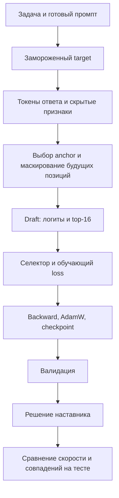

# Полный конвейер

## По шагам

1. Захват. Target читает промпт и генерирует до $G \le 320$ токенов. Его ID
   становятся метками, его скрытые состояния становятся входом. Дальше по
   конвейеру захваченное уже не меняется.
2. Anchor и маска. Один известный токен ответа становится anchor. Draft получает
   его и маскированные позиции, плюс признаки target до anchor.
3. Проход draft. Шесть decoder-слоёв дают скрытые состояния блока, замороженная
   output head превращает их в логиты.
4. Два лосса. Cross-entropy по всему словарю учит порядок среди всех $V$ токенов.
   Loss селектора учит порядок внутри top-16.
5. Обновление. Backward, clipping, AdamW. Пишутся checkpoint, наставник может
   вмешаться с learning rate.
6. Валидация. Offline-метрики на отложенных ответах, в двух фиксированных окнах
   на ответ.
7. Наставник. Отдельная LLM читает историю метрик и решает, продолжать ли и с
   каким learning rate.
8. Бенчмарк. Экспортированный draft сравнивается с родителем и с режимом без
   draft на фиксированном наборе запросов.

## Что делает наставник

DeepSeek смотрит на сводки и решает про продолжение и learning rate. Он не
поставляет токены и скрытые признаки основной модели и не входит в обучающий
граф. Подробнее в разделе
[Выбор checkpoint](../workflow/checkpoint-selection.md).

## Куда уходит время

Шаги оптимизатора не определяют длительность прогона:

$$
T_{\text{total}}
=
T_{\text{capture}}
+
T_{\text{loading}}
+
T_{\text{train}}
+
T_{\text{validation}}
+
T_{\text{mentor}}
+
T_{\text{benchmark}}
+
T_{\text{restore}} .
$$

Большая часть может уйти на генерацию target и на сравнительный прогон, хотя сам
draft получает несколько десятков обновлений. Поэтому счётчик
[854 метки](../validation/training-positions.md) мало говорит об общей стоимости.
