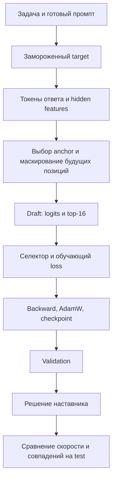

# Как обучается DFlash2: формулы и наш прогон

13 ноября 2026.

Это разбор конкретного trainer, которым выполнялся Stage-2. Рядом с формулами
есть пояснения и числовые примеры. Общая теория speculative decoding отделена
от того, что действительно реализовано и измерено у нас.

У DFlash две разные задачи по сравнению с обычным дообучением LLM. Основная
модель уже умеет отвечать. Маленький draft учится предугадывать её следующие
токены, чтобы основная модель могла проверять несколько токенов за один проход.
В нашем прогоне веса основной модели не менялись.

## Быстрая навигация

- [Обозначения и схема](#s1)
- [Target, признаки и anchor](#s3)
- [Attention, свёртки и селектор](#s5)
- [Loss и обновление весов](#s8)
- [Offline-метрики и validation](#s11)
- [854 позиции и несколько anchor](#s13)
- [Проверка на сервере и acceptance](#s15)
- [Ускорение и bootstrap](#s17)
- [Checkpoint и наставник](#s20)
- [Память и состав датасета](#s21)
- [Псевдокод шага](#s23)
- [Исходники и ссылки](#s25)

<a id="s1"></a>

## 1. Обозначения

| Символ | Значение | В нашем trainer |
| --- | --- | --- |
| $\phi$ | Веса основной модели, target | Замороженная Q5-модель |
| $\theta$ | Обучаемые веса draft | 526 251 520 параметров |
| $V$ | Размер словаря | 248 320 |
| $P$ | Число токенов промпта | Зависит от записи |
| $G$ | Число новых токенов target | Не более 320 в Stage-2 |
| $N=P+G$ | Длина всей захваченной последовательности | Промпт и ответ |
| $a$ | Индекс опорного токена, anchor | Выбирался один на запись |
| $b$ | Ширина блока вместе с anchor | 4 или 8 |
| $m=b-1$ | Число предсказываемых токенов блока | 3 или 7 |
| $B$ | Число записей в мини-батче | До 4 |
| $A$ | Число anchor на одну запись | 1 в выполненном проходе |
| $C$ | Окно target-признаков для draft | 384 позиции |
| $K$ | Размер списка кандидатов селектора | 16 |

Индексы токенов начинаются с нуля. $x_t$ обозначает ID токена, а не символ
или слово. Русское слово и одна строка кода могут занимать несколько токенов.

Полезно сразу различать:

- $G$: сколько токенов сгенерировал target.
- $m$: сколько будущих позиций предсказывает один обучающий блок.
- $A$: сколько таких блоков выбрано из одного ответа.
- Число обновлений optimizer: сколько раз изменились веса.

Это четыре разных счётчика.

Как читать записи:

- $\arg\max$ возвращает вариант с наибольшим значением.
- $\mathbf1[\text{условие}]$ равен единице, если условие выполнено, иначе нулю.
- $\odot$ означает умножение по координатам.
- $\mathbb E$ обозначает математическое ожидание.
- $\sum$ складывает значения, $\prod$ перемножает.
- $\log$ здесь является натуральным логарифмом.


<a id="s2"></a>

## 2. Общая последовательность



DeepSeek в этой схеме анализирует сводки и принимает решения о продолжении
и learning rate. Он не заменяет токены и hidden features основной модели.

<a id="s3"></a>

## 3. Как target создаёт обучающие данные

Авторегрессионная модель задаёт распределение следующего токена:

$$
p_\phi(x_t=v\mid x_{<t})
=
\operatorname{softmax}(\ell^T_t)_v.
$$

В нашей утилите capture использовался greedy-выбор:

$$
x_t=\arg\max_{v\in\{1,\ldots,V\}}\ell^T_{t,v}.
$$

Target сначала читает промпт, затем генерирует продолжение. Его собственные
token IDs становятся метками для draft. Это hard-label обучение. Полное
распределение вероятностей target в наш loss не подставлялось.

В частности, у нас не было такого KL-loss:

$$
\sum_v p_\phi(v)\log\frac{p_\phi(v)}{q_\theta(v)}.
$$

Это возможная другая постановка дистилляции, но не формула выполненного этапа.

### Из каких слоёв берутся признаки

Используются восемь входов слоёв target:

$$
\mathcal S=\{1,6,11,16,22,27,32,37\}.
$$

В целевой архитектуре есть несколько hyper-connection streams. Патч захвата
усредняет их. Если потоков $H_s$, то для слоя $\ell$:

$$
\bar h_t^{(\ell)}
=
\frac{1}{H_s}
\sum_{r=1}^{H_s}h_t^{(\ell,r)}.
$$

В использованной конфигурации потоков четыре. Усреднённые признаки выбранных
слоёв объединяются по последнему измерению:

$$
f_t=
\operatorname{concat}
\left(
\bar h_t^{(1)},\bar h_t^{(6)},\ldots,\bar h_t^{(37)}
\right).
$$

Каждый слой даёт 2048 значений:

$$
\dim f_t=8\cdot2048=16384.
$$

Дальше обучаемая проекция сжимает этот вектор:

$$
u_t=\operatorname{RMSNorm}(W_f f_t),
\qquad
W_f\in\mathbb R^{2048\times16384}.
$$

Для вектора $z$:

$$
\operatorname{RMSNorm}(z)_i
=
\gamma_i
\frac{z_i}
{\sqrt{\frac{1}{d}\sum_{j=1}^{d}z_j^2+\varepsilon}}.
$$

$\gamma_i$ обучается. В конфигурации $\varepsilon=10^{-6}$.

Замороженные признаки не означают, что контекст не влияет на обучение.
Например, градиент проекции содержит члены вида:

$$
\frac{\partial\mathcal L}{\partial W_f}
=
\sum_t
\frac{\partial\mathcal L}{\partial(W_f f_t)}
f_t^\top.
$$

Поэтому позиция может влиять на обновление через контекст, даже если её токен
не является отдельной предсказываемой меткой.

<a id="s4"></a>

## 4. Anchor и маскированный блок

Из ответа выбирается опорный токен $x_a$. Он уже известен. Draft получает:

$$
\left[
E(x_a),E(\text{MASK}),\ldots,E(\text{MASK})
\right].
$$

$E$ является замороженной embedding-таблицей target. ID MASK в нашей модели
равен 248077.

Переменная noise в коде обозначает этот маскированный вход. Здесь не добавляется
гауссов шум, как в распространённых формулах диффузии изображений. Один forward
предсказывает весь блок будущих токенов.

При $b=4$ вход выглядит так:

```text
Уже известно:      x[a]
Вход draft:       [x[a], MASK, MASK, MASK]
Цели предсказания:       x[a+1], x[a+2], x[a+3]
```

Здесь четыре позиции блока, но только три будущих токена. При $b=8$ будущих
позиций семь.

Target-признаки берутся до anchor, без будущих правильных ответов:

$$
f_{\max(0,a-C)},\ldots,f_{a-1}.
$$

Если контекст короче $C$, слева добавляются нули и закрываются attention mask.
Draft видит известный anchor через embedding и прошлое через target-признаки.

### Точный диапазон в выполненном коде

Anchor выбирался равномерно:

$$
a\sim\operatorname{UniformInt}(P,N-b-1).
$$

Верхняя граница включается. Код оставляет ещё одну позицию запаса относительно
самого широкого математически допустимого диапазона. Это важно при точном
подсчёте покрытия.

Ширина зависела от глобального шага $s$:

$$
b_s=
\begin{cases}
8,& s\bmod4=0,\\
4,& \text{иначе}.
\end{cases}
$$

На запись выбирался один anchor в данном проходе. Блок не проходил по всему
ответу скользящим окном.

<a id="s5"></a>

## 5. Что происходит внутри draft

Draft содержит шесть decoder-слоёв. Их выходы строятся с помощью attention,
MLP, residual connections и дополнительных свёрток DFlash2.

### Attention

Для одной attention-head схема имеет вид:

$$
\operatorname{Attention}(Q,K,V)
=
\operatorname{softmax}
\left(
\frac{QK^\top}{\sqrt{d_h}}+M
\right)V.
$$

$M$ закрывает недоступные позиции, $d_h=128$.
Query берётся из состояний блока. Key и value берутся из target-контекста
и текущих состояний блока:

$$
Q=ZW_Q^\top,
\quad
K=[U;Z]W_K^\top,
\quad
V=[U;Z]W_V^\top.
$$

Здесь строки матриц $Z$ и $U$ соответствуют позициям, а точка с запятой означает
объединение строк. В коде также есть отдельная RMS-нормализация Q/K и rotary positional embeddings.
В формуле выше они не выписаны, чтобы показать сам обмен информацией.
У модели 32 query-head и 8 key/value-head.

Один rotary-поворот пары координат можно записать так:

$$
\begin{bmatrix}
q'_i\\q'_{i+d_h/2}
\end{bmatrix}
=
\begin{bmatrix}
\cos\omega_{p,i}&-\sin\omega_{p,i}\\
\sin\omega_{p,i}&\cos\omega_{p,i}
\end{bmatrix}
\begin{bmatrix}
q_i\\q_{i+d_h/2}
\end{bmatrix},
\qquad
\omega_{p,i}=p\,\Theta^{-2i/d_h}.
$$

Здесь $p$ является абсолютной позицией. В конфигурации $\Theta=10^7$.
Здесь выписаны пары координат из двух половин head, как в используемом Qwen
rotate-half. В других реализациях эти же пары могут храниться в другом порядке.

Внутри блока attention может смотреть на другие маскированные позиции.
Это не раскрывает правильные будущие токены: там стоят MASK, а не gold.

### MLP

Для SwiGLU-MLP:

$$
\operatorname{MLP}(z)
=
W_{\rm down}
\left(
\operatorname{SiLU}(W_{\rm gate}z)
\odot
W_{\rm up}z
\right),
$$

$$
\operatorname{SiLU}(x)=x\,\sigma(x).
$$

Промежуточная ширина в нашем draft равна 6144.

### Динамическая свёртка DFlash2

Упрощённая запись одной из свёрток:

$$
\operatorname{Conv}(z)_{t,g,c}
=
\sum_{r=0}^{1}
\left(
w_{r,g,c}+d_{t,r,g}
\right)z_{t-r,g,c}.
$$

- Два taps: текущая и предыдущая позиции.
- Каналы объединены в группы по 16.
- $w$ являются обучаемыми базовыми коэффициентами.
- $d$ вычисляются из состояния токена линейной проекцией.
- В начале блока отсутствующая предыдущая позиция заменяется нулём.

В коде есть свёртки до и после attention, а также до и после MLP.
Коэффициенты post-свёртки получаются на стадии подготовки соответствующего
субслоя. Они не обязательно вычисляются заново из его выхода.

Эти свёртки помогают связывать соседние позиции блока. Их параметры входят
в тот же обучающий граф. Отдельного набора меток для них нет.

<a id="s6"></a>

## 6. Logits, вероятности и top-16

Пусть $z_{i,j}$ является выходом draft для записи $i$ и будущей позиции $j$.
Замороженный output head target переводит его в logits:

$$
\ell_{i,j}=W_{\rm out}z_{i,j},
\qquad
\ell_{i,j}\in\mathbb R^V.
$$

В нашем trainer использовался обычный `F.linear` без дополнительной
температуры или softcap в этом месте.

Вероятность по полному словарю:

$$
q_{i,j}(v)=
\frac{\exp\ell_{i,j,v}}
{\sum_{u=1}^{V}\exp\ell_{i,j,u}}.
$$

Для численной устойчивости можно вычесть максимальный logit:

$$
q(v)=
\frac{\exp(\ell_v-\ell_{\max})}
{\sum_u\exp(\ell_u-\ell_{\max})}.
$$

Результат математически тот же, но риск переполнения меньше.

Для селектора берутся кандидаты:

$$
\mathcal C_{i,j}
=
\operatorname{TopK}_{v}\ell_{i,j,v},
\qquad K=16.
$$

Список создаётся по logits draft. Он не приходит от DeepSeek или target.

<a id="s7"></a>

## 7. Как селектор выбирает согласованный путь

Селектор учитывает не только текущий кандидат $v$, но и предыдущий токен $r$:

$$
s_{i,j}(v\mid r)
=
\ell_{i,j,v}

\sum_{k=1}^{R}
A_{r,k}
\left(W_gz_{i,j}\right)_k
B_{v,k}.
$$

В нашем коде $R=256$.

- $A$ является таблицей predecessor codebook.
- $B$ является таблицей successor codebook.
- $W_gz$ определяет, какие связи важны в данном контексте.
- Второе слагаемое может изменить порядок исходных top-16.

Пример с двумя кандидатами:

| Кандидат | Исходный logit | Поправка связи | Итог |
| --- | ---: | ---: | ---: |
| Первый | 2,0 | -0,8 | 1,2 |
| Второй | 1,6 | +0,3 | 1,9 |

Без селектора победил бы первый кандидат. После поправки выбирается второй.
Его вероятность в этом примере:

$$
\frac{e^{1.9}}{e^{1.2}+e^{1.9}}
\approx0.6682.
$$

### Что отличается при обучении и генерации

При обучении предыдущий токен берётся из gold-продолжения target:

$$
r_{i,j}=x_{a_i+j-1}.
$$

Это teacher forcing для связи селектора.

При greedy-генерации:

$$
\hat y_j
=
\arg\max_{v\in\mathcal C_j}s_j(v\mid\hat y_{j-1}),
\qquad
\hat y_0=x_a.
$$

После первой позиции используется уже выбранный токен. В нашей Python-модели
и проверенном runtime путь выбирается последовательно по текущим scores.
Это не формула глобального перебора всех $16^m$ путей.

<a id="s8"></a>

## 8. Loss основной головы

Правильный токен для будущей позиции $j$:

$$
y_{i,j}=x_{a_i+j}.
$$

Cross-entropy по полному словарю:

$$
\mathcal L_{\rm CE}
=
-\frac{1}{Bm}
\sum_{i=1}^{B}
\sum_{j=1}^{m}
\log q_{i,j}(y_{i,j}).
$$

Чем меньше вероятность правильного токена, тем больше штраф.
Используется натуральный логарифм:

$$
-\log0.8\approx0.2231,
\qquad
-\log0.2\approx1.6094.
$$

Даже если правильный токен не попал в top-16, этот loss продолжает учить
основную голову draft.

Для одного logit градиент имеет знакомую форму:

$$
\frac{\partial\mathcal L_{\rm CE}}{\partial\ell_{i,j,v}}
=
\frac{
q_{i,j}(v)-\mathbf1[v=y_{i,j}]
}{Bm}.
$$

У правильного токена вероятность подталкивается вверх. У остальных вниз.
Дальше chain rule переносит этот сигнал в обучаемые параметры draft.
Замороженные $W_{\rm out}$ и $E$ в optimizer не входят.

<a id="s9"></a>

## 9. Loss селектора и общий objective

Сначала отмечается, есть ли gold среди кандидатов:

$$
\chi_{i,j}
=
\mathbf1[y_{i,j}\in\mathcal C_{i,j}],
\qquad
M_{\rm hit}=\sum_{i,j}\chi_{i,j}.
$$

Селектор задаёт распределение внутри своего списка:

$$
\tilde q_{i,j}(v\mid r)
=
\frac{\exp s_{i,j}(v\mid r)}
{\sum_{u\in\mathcal C_{i,j}}\exp s_{i,j}(u\mid r)}.
$$

Тогда:

$$
\mathcal L_{\rm sel}
=
-\frac{1}{M_{\rm hit}}
\sum_{i,j:\chi_{i,j}=1}
\log\tilde q_{i,j}(y_{i,j}\mid r_{i,j}).
$$

Если $M_{\rm hit}=0$, в коде этот член равен нулю. Выбрать отсутствующий
токен невозможно. Это не повод отключать полный CE из предыдущего раздела.

Фактический общий loss Stage-2:

$$
\boxed{
\mathcal L=
\mathcal L_{\rm CE}
+0.5\,\mathcal L_{\rm sel}
}
$$

Например:

$$
3.319237010553479
+0.5\cdot1.0976521242409945
=3.868063072673976.
$$

Сохранённый validation loss равен примерно 3,86806307.
Малые отличия последних знаков связаны с float и агрегацией.

Если считать perplexity основной головы на этих оценочных позициях:

$$
\operatorname{PPL}_{\rm head}
=
\exp(\mathcal L_{\rm CE})
\approx
\exp(3.319237)
\approx
27.64.
$$

Экспонента общего loss, содержащего ещё selector CE, не является обычной
perplexity. И даже PPL основной головы здесь относится к выбранным anchor-блокам,
а не к оценке всего корпуса обычной языковой модели.

В нашем варианте все позиции блока имели одинаковый вес. Дополнительного
экспоненциального затухания по удалённости в этом этапе не было.

### Возможный вариант с весами позиций

Если заранее задать $\omega_j\ge0$, можно использовать:

$$
\mathcal L_{\rm CE}^{(\omega)}
=
-\frac{
\sum_{i,j}\omega_j\log q_{i,j}(y_{i,j})
}{
\sum_{i,j}\omega_j
}.
$$

Для selector аналогичная формула берёт только $\chi_{i,j}=1$.
Например, убывающие веса могут больше выделять ближайшие позиции.
Это описание возможного нового опыта, а не уже выполненная настройка.

<a id="s10"></a>

## 10. Как градиент превращается в новые веса

### Gradient clipping

После backward и снятия AMP scale вычисляется общая норма:

$$
\|g\|_2
=
\sqrt{\sum_p\|g_p\|_2^2}.
$$

При превышении единицы градиент уменьшается:

$$
\bar g=g\cdot
\min\left(1,\frac{1}{\|g\|_2}\right).
$$

При нулевой норме он остаётся нулём. Библиотека добавляет небольшую техническую
защиту от деления на ноль. Порог в нашем коде равен 1,0.

### AdamW

Для внутреннего шага optimizer $k$:

$$
m_k=\beta_1m_{k-1}+(1-\beta_1)\bar g_k,
$$

$$
v_k=\beta_2v_{k-1}+(1-\beta_2)\bar g_k^2,
$$

$$
\hat m_k=\frac{m_k}{1-\beta_1^k},
\qquad
\hat v_k=\frac{v_k}{1-\beta_2^k},
$$

$$
\boxed{
\theta_k
=
(1-\eta_k\lambda_{\rm wd})\theta_{k-1}
-
\eta_k\frac{\hat m_k}{\sqrt{\hat v_k}+\varepsilon}
}
$$

Операции над векторами покоординатные. Параметры использованного AdamW:

$$
\beta_1=0.9,\quad
\beta_2=0.999,\quad
\varepsilon=10^{-8},\quad
\lambda_{\rm wd}=0.01.
$$

Weight decay отделён от моментов градиента. В этом trainer он задан для обеих
групп параметров. Уравнения и соглашения: [PyTorch AdamW](https://docs.pytorch.org/docs/2.8/generated/torch.optim.AdamW.html).

### Learning rate

Базовый темп Stage-2:

$$
\eta_{\rm base}=2.5\cdot10^{-6}.
$$

Для входной проекции и `hidden_norm`:

$$
\eta_{\rm projection}=3\eta_{\rm base}=7.5\cdot10^{-6}.
$$

Код применяет warmup:

$$
w(s)=\min\left(1,\frac{s}{100}\right),
\qquad
\eta(s)=\eta_{\rm base}w(s).
$$

$s$ здесь является глобальным номером шага. Stage-2 продолжался с шага 9074,
поэтому warmup уже был равен единице. Новый warmup с нуля не запускался.

### AMP и повтор при overflow

Чтобы малые FP16-градиенты не терялись, loss временно масштабируется:

$$
\mathcal L_{\rm scaled}=S\mathcal L,
\qquad
g_{\rm scaled}=Sg,
\qquad
g=g_{\rm scaled}/S.
$$

Математический градиент после unscale остаётся тем же. Clipping выполняется
после unscale.

Если градиенты содержат Inf или NaN, optimizer не обновляет веса. Scale
уменьшается, и тот же батч с теми же anchor повторяется. Неконечный forward loss
является отдельной ошибкой и завершает шаг.

При старте с нуля задан scale 1024. В продолженном Stage-2 использовалось
сохранённое значение 256. В этом этапе overflow-повторов не было.
Порядок операций соответствует [правилам PyTorch AMP](https://docs.pytorch.org/docs/2.8/notes/amp_examples.html).

<a id="s11"></a>

## 11. Формулы offline-метрик

В нашем валидаторе selector проверяется с правильным предыдущим токеном.
Обозначим выбранный при такой проверке токен $\hat y_{i,j}^{\rm TF}$.

$$
c_{i,j}
=
\mathbf1[\hat y_{i,j}^{\rm TF}=y_{i,j}].
$$

### Token accuracy

$$
\operatorname{Accuracy}
=
\frac{1}{Bm}\sum_{i,j}c_{i,j}.
$$

### Top-16 recall

$$
\operatorname{Recall@16}
=
\frac{1}{Bm}\sum_{i,j}\chi_{i,j}.
$$

Точность выбора не может быть выше доли позиций, где gold вообще есть в списке.
При общем одинаковом знаменателе можно разложить ошибки:

$$
\begin{aligned}
\text{правильно выбран} &= \operatorname{Accuracy},\\
\text{gold есть, выбран другой} &=
\operatorname{Recall@16}-\operatorname{Accuracy},\\
\text{gold отсутствует} &=1-\operatorname{Recall@16}.
\end{aligned}
$$

Для лучшего checkpoint это примерно:

- 50,45% правильно выбранных токенов.
- 23,38% позиций, где gold есть, но выбран другой кандидат.
- 26,17% позиций, где gold не попал в top-16.

Условная точность при наличии gold:

$$
\frac{0.5044643}{0.7382813}\approx0.6833.
$$

Это около 68,33% на данном offline-срезе. Это не отдельное измерение
runtime acceptance и не сравнимо напрямую с условными по позиции таблицами
для другой модели из статьи.

### Prefix proxy

Считается длина непрерывного правильного начала:

$$
J_i^{\rm offline}
=
\sum_{j=1}^{m}
\prod_{r=1}^{j}c_{i,r}.
$$

Пример:

```text
Правильность позиций: [1, 1, 0, 1, 1, 0, 1]
Accuracy:             5 / 7
Prefix:               2
```

После первой ошибки остальные правильные токены уже не удлиняют prefix.
У блока `[1, 1, 1, 0, 0, 0, 0]` accuracy ниже, но prefix равен трём.

Среднее по примерам:

$$
\operatorname{PrefixProxy}
=
\frac{1}{B}\sum_i J_i^{\rm offline}.
$$

В нашем валидаторе $b=8$, поэтому максимум равен семи. Значение 2,621
не означает, что сервер в среднем принял 2,621 из своих трёх draft-токенов.
У этих чисел разные процедуры измерения.

<a id="s12"></a>

## 12. Какие позиции проверяет validation

Для каждого сохранённого validation-ответа берутся две точки:

$$
a_f
=
P+\left\lfloor(G-8)f\right\rfloor,
\qquad
f\in\{0.25,0.7\}.
$$

Затем проверяется блок ширины 8. При 256 примерах получается:

$$
256\cdot2\cdot7=3584
$$

оценки будущих позиций за один полный validation. Это не обязательно 3584
уникальных токена: окна могут пересекаться.

Пусть $u$ обозначает комбинацию мини-батча и одной из двух точек, а $n_u$
является размером батча. Валидатор агрегирует метрику $M_u$:

$$
\overline M
=
\frac{\sum_u n_u M_u}{\sum_u n_u}.
$$

Полный CE и accuracy при одинаковой ширине сводятся к обычной оценке по позициям.
У selector CE сначала берётся среднее по попаданиям top-16 внутри батча,
а затем среднее по батчам с весами $n_u$. Это не всегда равно одному общему
среднему по всем covered-позициям.

<a id="s13"></a>

## 13. Откуда взялись 854 обучающие позиции

В каждом принятом батче $s$ было $n_s$ записей. Точный счётчик:

$$
\boxed{
M_{\rm train}
=
\sum_s n_s(b_s-1)
}
$$

Нельзя заменить все $n_s$ на четыре: последние батчи порций были неполными.

| Конечный шаг порции | Записей с $b=4$ | Записей с $b=8$ | CE-позиций |
| --- | ---: | ---: | ---: |
| 9076 | 4 | 4 | 40 |
| 9090 | 42 | 12 | 210 |
| 9102 | 33 | 12 | 183 |
| 9116 | 40 | 13 | 211 |
| 9130 | 42 | 12 | 210 |
| Всего | 161 | 53 | 854 |

Проверка:

$$
3\cdot161+7\cdot53=483+371=854.
$$

Доля относительно числа сгенерированных токенов:

$$
\frac{854}{67449}\cdot100\%
\approx1.2661\%.
$$

Это доля прямых CE-меток. Она не является долей изменённых весов или долей
всего вычислительного графа, участвовавшего в backward.


Loss каждого батча усреднялся по его позициям. Поэтому счётчик 854 не задаёт
суммарный вес градиента: батчи с тремя и семью целями имеют собственные знаменатели.

Полное время работы также не равно времени 56 обновлений:

$$
T_{\rm total}
=
T_{\rm capture}
+
T_{\rm loading}
+
T_{\rm train}
+
T_{\rm validation}
+
T_{\rm mentor}
+
T_{\rm benchmark}
+
T_{\rm restore}.
$$

Большая часть работы может приходиться на target и сравнение, даже если
непосредственных обновлений draft немного.

<a id="s14"></a>

## 14. Что математически меняют несколько anchor

Для $A$ anchor можно усреднять блоковые loss:

$$
\widehat{\mathcal L}_A
=
\frac1A\sum_{r=1}^{A}\mathcal L(\theta;a_r).
$$

При одинаковом распределении точек:

$$
\mathbb E[\widehat{\mathcal L}_A]
=
\mathbb E_a[\mathcal L(\theta;a)].
$$

В среднем оптимизируется та же задача, но оценивается больше мест ответа.
Суммирование без деления на $A$ изменило бы масштаб градиента и смешало бы
эффект покрытия с изменением эффективного learning rate.

При независимых оценках:

$$
\operatorname{Var}(\widehat{\mathcal L}_A)
=
\frac{\sigma^2}{A}.
$$

В одном ответе окна коррелируют. Для одинаковой попарной корреляции $\rho$
получается:

$$
\operatorname{Var}(\widehat{\mathcal L}_A)
=
\frac{\sigma^2}{A}\left(1+(A-1)\rho\right).
$$

Поэтому восемь точек не равны восьми независимым новым задачам.
Если повторить одну и ту же точку $A$ раз, средний loss в детерминированном
случае вообще не изменится:

$$
\frac1A\sum_{r=1}^{A}\mathcal L(\theta;a)
=
\mathcal L(\theta;a).
$$

### Ожидаемое число уникальных меток

Для точного диапазона нашего кода число допустимых anchor:

$$
L=G-b.
$$

Пусть $c_t$ является числом допустимых точек, чей блок покрывает позицию $t$.

Для диапазона anchor из раздела 4:

$$
c_t=
\max\left(
0,\,
\min(t-1,N-b-1)-\max(P,t-m)+1
\right).
$$

Если $A$ точек независимо выбираются с возвращением:

$$
\Pr(t\text{ покрыта})
=
1-\left(1-\frac{c_t}{L}\right)^A,
$$

$$
\mathbb E[U_A]
=
\sum_t
\left[
1-\left(1-\frac{c_t}{L}\right)^A
\right].
$$

При $G=320$ и $b=4$ точный подсчёт для такого диапазона даёт примерно:

| Anchor на запись | Loss-позиций с повторениями | Ожидаемо уникальных позиций |
| --- | ---: | ---: |
| 1 | 3 | 3,00 |
| 4 | 12 | 11,83 |
| 8 | 24 | 23,22 |

Это расчёт покрытия, не прогноз ускорения. Рост acceptance нужно измерять
после обучения.

<a id="s15"></a>

## 15. Как проверяется draft на сервере

Здесь начинается inference. В нашем runtime максимальное предложение
содержит три будущих токена.

### Детерминированный greedy-случай

Пусть предложены $d_1,\ldots,d_\gamma$.
Target проверяет их на тех же условных префиксах.
Число принятых токенов:

$$
J=
\max\left\{
j:
d_r=\arg\max_v p_\phi(v\mid x_{<a},x_a,d_{<r})
\ \text{для всех }r\le j
\right\}.
$$

При первой ошибке остаток draft отбрасывается. Target выдаёт правильный токен
на месте ошибки. Если принят весь блок, он может добавить следующий bonus-токен.

В идеальном полном цикле:

$$
N_{\rm out,cycle}=J+1.
$$

EOS, граница запрошенной длины и особенности replay могут уменьшить число
реально выданных токенов последнего цикла.

### Вероятностный speculative sampling

Это общая формула алгоритма, а не описание нашего greedy-бенчмарка.
Пусть $Q_j$ является фактическим распределением предложения draft, а $P_j$
распределением target при нужных настройках sampling.

Для предложенного $d_j\sim Q_j$:

$$
\alpha_j=
\min\left(1,\frac{P_j(d_j)}{Q_j(d_j)}\right).
$$

Токен принимается с вероятностью $\alpha_j$. При отклонении корректирующее
распределение:

$$
R_j(v)
=
\frac{\max(P_j(v)-Q_j(v),0)}
{\sum_u\max(P_j(u)-Q_j(u),0)}.
$$

Для отсутствующего кандидата $Q_j(v)=0$. В этих формулах нужно использовать
именно распределение реального предложения с его фильтрами, а не произвольный
softmax, который фактически не применялся.

Это условие корректного rejection sampling. Оно не доказывает, что наш C++
runtime при всех режимах реализует его без расхождений. В выполненном сравнении
ответы speculative и no-draft часто различались, и причина ещё не установлена.
Первичный источник общей схемы: [Fast Inference from Transformers via Speculative Decoding](https://arxiv.org/abs/2211.17192).

<a id="s16"></a>

## 16. Acceptance и ожидаемая длина

Для циклов $r=1,\ldots,T$ обозначим число предложений $D_r$ и число принятых $J_r$.

Доля принятых draft-токенов:

$$
\operatorname{AcceptanceRate}
=
\frac{\sum_r J_r}{\sum_r D_r}.
$$

Средняя длина результата полного цикла с bonus:

$$
\overline L_{\rm cycle}
\approx
1+\frac{\sum_rJ_r}{T}.
$$

В проверенном исходнике runtime выводится именно
`1 + n_draft_accepted / n_draft_verif_steps`.
Смысл знаменателя и обработку границ нужно сохранять при сравнении режимов.

### Через вероятность правильного префикса

При фиксированной длине $\gamma$:

$$
\mathbb E[J]
=
\sum_{k=1}^{\gamma}\Pr(J\ge k).
$$

Пусть $a_j$ обозначает условную вероятность принять позицию $j$, если все
предыдущие уже приняты. Тогда:

$$
\Pr(J\ge k)=\prod_{j=1}^{k}a_j.
$$

Если условные вероятности одинаковы и равны $a$:

$$
\mathbb E[L_{\rm cycle}]
\approx
1+\sum_{k=1}^{\gamma}a^k.
$$

Для $a=0.7$ и $\gamma=3$:

$$
1+0.7+0.49+0.343=2.533.
$$

Здесь $a$ не является общей долей accepted/drafted из первой формулы.
Нельзя также подставлять вместо $a$ среднюю offline accuracy и считать
результат измерением сервера.

<a id="s17"></a>

## 17. Почему acceptance не равен ускорению

Пусть:

- $t_{\rm AR}$ является временем обычного декодирования одного токена.
- $t_{\rm draft}$ является временем предложения блока.
- $t_{\rm verify}$ является временем проверки блока target.
- $t_{\rm overhead}$ включает служебные операции и откат состояния.

В грубой стационарной модели:

$$
\boxed{
\operatorname{Speedup}
\approx
\frac{
\mathbb E[L_{\rm cycle}]\,t_{\rm AR}
}{
t_{\rm draft}+t_{\rm verify}+t_{\rm overhead}
}
}
$$

Draft может угадывать лучше, но тратить на это слишком много времени.
Большой блок тоже может оказаться медленнее маленького.
Эта формула объясняет компромисс, но реальные времена нужно измерять.

<a id="s18"></a>

## 18. Как считалась скорость в нашем benchmark

Общая decode-скорость режима:

$$
v_{\rm decode}
=
\frac{\sum_i n_i}
{\sum_i t_{i,\rm decode}}.
$$

Скорость с учётом полного времени запросов:

$$
v_{\rm wall}
=
\frac{\sum_i n_i}
{\sum_i t_{i,\rm wall}}.
$$

Это отношения сумм. Они не равны простому среднему скоростей запросов.
Медиана также является другой статистикой.

Выполнено:

$$
128\text{ заданий}\cdot2\text{ повтора}\cdot3\text{ режима}
=768\text{ запросов}.
$$

Получились:

| Режим | Decode, токенов/с |
| --- | ---: |
| Без draft | 54,06343 |
| Родитель v1.2.0 | 68,67661 |
| Кандидат Stage-2 | 68,76792 |

Относительное изменение:

$$
\Delta_v
=
100\left(
\frac{v_{\rm candidate}}{v_{\rm parent}}-1
\right)
\approx0.13295\%.
$$

Прирост кандидата относительно no-draft составляет около 27,20%.
Почти весь этот выигрыш уже был у родителя.

### Парный bootstrap

Единицей повторной выборки было задание, вместе с обоими повторами.
В каждой из 5000 выборок одни и те же индексы заданий использовались
для родителя и кандидата:

$$
v_z^*
=
\frac{\sum_{i\in I^*}N_{i,z}}
{\sum_{i\in I^*}T_{i,z}},
\qquad
\Delta^*
=100\left(\frac{v_c^*}{v_p^*}-1\right).
$$

Границы 95% интервала берутся как эмпирические квантили 0,025 и 0,975
полученных $\Delta^*$:

$$
[\,0.0070\%,\ 0.2549\%\,].
$$

Интервал относится к различиям между заданиями данного набора.
Режимы выполнялись последовательно. Bootstrap не убирает дрейф температуры
и времени. Поэтому узко положительный интервал не делает этот результат
доказательством устойчивого общего выигрыша.

<a id="s19"></a>

## 19. Как понимать изменение loss и accuracy

Относительное уменьшение loss:

$$
\Delta_{\rm loss}
=
100\frac{
\mathcal L_{\rm parent}-\mathcal L_{\rm best}
}{
\mathcal L_{\rm parent}
}.
$$

Для нашего результата:

$$
100\frac{3.86914256-3.86806307}{3.86914256}
\approx0.02790\%.
$$

Изменение accuracy в процентных пунктах:

$$
\Delta_{\rm pp}
=
100(A_{\rm new}-A_{\rm old})
\approx0.05580.
$$

То есть 50,39063% превратились в 50,44643%.
Процентный пункт не равен относительному проценту.
Ни одна из этих формул не превращает уменьшение loss в такой же процент
ускорения.

<a id="s20"></a>

## 20. Выбор checkpoint и решение наставника

Лучшие веса выбирались по минимальному validation loss среди сохранённых
проверок:

$$
s^*
=
\arg\min_{s\in\mathcal E}\mathcal L_{\rm val}(s).
$$

$\mathcal E$ является множеством проверенных checkpoint, а не всех внутренних
шагов. Новые проверки после порций Stage-2 выполнялись на шагах
9076, 9090, 9102, 9116 и 9130. Сохранённый результат родителя на шаге 9074
тоже участвовал в выборе best.

Лучший шаг получился 9090, хотя последний обученный шаг был 9130.
Слово «лучший» здесь относится к выбранному loss. Оно не означает максимум
скорости на всех задачах.

Наставник получал скользящие средние, например:

$$
\mu_{\rm recent}
=
\frac1{10}\sum_{i=t-9}^{t}L_i.
$$

И возраст лучшего checkpoint:

$$
\operatorname{Age}_{\rm best}=s_{\rm current}-s_{\rm best}.
$$

Но решение наставника не задаётся отдельной доказанной формулой сходимости:

$$
\pi_{\rm LLM}(\text{метрики},\text{история})
\longrightarrow
(\text{continue/stop},\eta_{\rm next},\text{reason}).
$$

Это решение модели по переданной информации. В выполненном этапе окна
частично включали историю родителя. Остановка после 56 обновлений не доказывает,
что все возможности нового корпуса исчерпаны.

<a id="s21"></a>

## 21. Сколько места занимают признаки и checkpoint

### Признаки

Один токен хранит восемь векторов по 2048 значений FP16:

$$
8\cdot2048\cdot2=32768\text{ байт}=32\text{ KiB}.
$$

Для последовательности из $N$ токенов:

$$
F_{\rm bytes}=N\cdot32768.
$$

Пример: промпт 5000 токенов и ответ 320 токенов:

$$
F=5320\cdot32768
=174325760\text{ байт}
=166.25\text{ MiB}.
$$

Планировщик использует консервативную оценку:

$$
\widehat F_i
=
(P_i+G_{\max}+1)\cdot32768.
$$

Порция должна удовлетворять:

$$
\sum_{i\in\text{shard}}\widehat F_i
\le F_{\rm budget}.
$$

Дополнительно ограничено число записей в порции. В выполненном плане бюджет
признаков train-порции был до 8 GiB. Это не лимит всего занятого места.

### Полное состояние обучения

Грубая оценка для $W$ обучаемых параметров:

$$
\underbrace{4W}_{\text{текущие FP32-веса}}
+
\underbrace{2W}_{\text{лучшие FP16-веса}}
+
\underbrace{4W+4W}_{\text{два момента Adam}}
\approx14W\text{ байт}.
$$

При $W=526251520$ это около 6,862 GiB до небольшой служебной части.

При атомарной замене некоторое время существуют старый и новый checkpoint.
Поэтому рабочее место должно покрывать примерно:

$$
F_{\rm validation}
+
F_{\rm train\ shard}
+
2F_{\rm checkpoint}
+
F_{\rm GGUF}
+
F_{\text{прочее}}.
$$

Оценка не заменяет фактическую проверку диска. Metadata, выделенные блоки,
hard links и другие процессы могут менять реальную картину.

### Почему export может немного отличаться

Основные веса обучения FP32, а экспорт draft F16:

$$
W_{\rm export}
=
\operatorname{Round}_{\rm FP16}(W_{\rm master}).
$$

Слишком маленькое изменение может исчезнуть после округления.
Validation в Python и запуск GGUF также используют разные вычислительные
пути. Поэтому небольшой выигрыш offline-loss нужно проверять в реальном
runtime, а не переносить автоматически.

<a id="s22"></a>

## 22. Формулы смеси датасета

Если 80% train относится к новым задачам, а 20% к replay:

$$
p_{\rm train}
=
0.8\,p_{\rm new}
+
0.2\,p_{\rm replay}.
$$

Для 600 контекстов:

$$
N_{\rm new}=480,
\qquad
N_{\rm replay}=120.
$$

Такая смесь может помогать сохранять старое поведение, но конкретные доли
являются предложением для опыта.

Разделение по семействам должно удовлетворять:

$$
\mathcal F_{\rm train}\cap\mathcal F_{\rm val}
=
\mathcal F_{\rm train}\cap\mathcal F_{\rm test}
=
\mathcal F_{\rm val}\cap\mathcal F_{\rm test}
=
\varnothing.
$$

Два языковых варианта одного файла не превращаются в независимые источники.
Разделение по строкам JSONL без учёта семейства для этого недостаточно.

<a id="s23"></a>

## 23. Один обучающий шаг в псевдокоде

```python
# Target заранее сгенерировал token_ids и features.
# Его веса не меняются.

batch = next_batch()
width = 8 if global_step % 4 == 0 else 4
anchors = choose_one_anchor_per_record(batch, width)

context = last_target_features_before_anchor(batch, anchors, limit=384)
noise = [anchor_token, MASK, ..., MASK]
gold = next_target_tokens(batch, anchors, count=width - 1)
gold_previous = target_predecessors(batch, anchors, count=width - 1)

hidden = draft(noise, context)
logits = frozen_target_head(hidden[:, 1:])

ce = full_vocabulary_cross_entropy(logits, gold)
candidates = topk(logits, k=16)
scores = selector(logits, hidden[:, 1:], gold_previous, candidates)
selector_ce = cross_entropy_where_gold_is_in_candidates(scores, gold)

loss = ce + 0.5 * selector_ce

scaled_loss = scaler.scale(loss)
scaled_loss.backward()
scaler.unscale_(optimizer)

if gradients_are_finite():
    clip_grad_norm_(draft.parameters(), max_norm=1.0)
    scaler.step(optimizer)
    scaler.update()
else:
    # Веса не обновляются. Scale уменьшается.
    # Повторяется тот же батч с теми же anchors.
    skip_update_and_retry_same_batch()
```

Псевдокод показывает вычисления. В настоящем коде есть дополнительные
проверки файлов, shapes, чисел, seed, восстановление состояния и сохранение.

<a id="s24"></a>

## 24. Что нельзя вывести только из формул

- Низкий loss не гарантирует высокий runtime acceptance.
- Высокий acceptance не гарантирует ускорение с учётом стоимости draft.
- Одинаковые ответы родителя и кандидата сами по себе не являются неудачей:
  сохранение ответа ожидается от корректного ускорения.
- Расхождение с no-draft требует отдельного разбора precision, sampling,
  batching и проверки/отката состояния. Дефект конкретного узла ещё не доказан.
- 854 прямые метки являются установленным фактом. Что именно увеличение их
  числа даст нужный прирост, пока является проверяемой гипотезой.
- Больше данных или больше anchor не отменяют необходимость независимого test.
- Полное окно 262144 токена этим Stage-2 benchmark не проверялось.

<a id="s25"></a>

## 25. По каким исходникам сверялся документ

| Часть | Файл или функция |
| --- | --- |
| Capture и сохранение признаков | `capture/capture.cpp`, патч усреднения streams |
| Проекция, attention, MLP, свёртки, селектор | `source/zmodel.py` |
| CE, selector CE, sampling anchor, validation | `scripts/train_shard.py` |
| Clipping и обработка AMP | `scripts/amp_step.py` |
| Скользящие окна и возраст checkpoint | `scripts/strategy.py` |
| Расчёт скорости | `scripts/benchmark.py` |
| Серверные счётчики acceptance | `tools/server/server-context.cpp` совместимого runtime |

Названия относятся к разобранной реализации. Это не утверждение, что
любая сторонняя версия DFlash2 использует ровно те же коэффициенты и метрики.

Первичные источники для общей схемы и библиотечных операций:

- [DFlash: Block Diffusion for Flash Speculative Decoding](https://arxiv.org/html/2602.06036v1).
- [DFlash2: описание метода](https://inco.ai/blog/dflash2/).
- [NVIDIA: DFlash2 trainer и определения метрик](https://docs.nvidia.com/nemo/automodel/nightly/nemo-automodel/nemo_automodel/components/speculative/dflash/dflash2_core).
- [Общая схема speculative decoding](https://arxiv.org/abs/2211.17192).
- [PyTorch AdamW](https://docs.pytorch.org/docs/2.8/generated/torch.optim.AdamW.html).
- [PyTorch AMP](https://docs.pytorch.org/docs/2.8/notes/amp_examples.html).

Числа выполненного этапа сверены с сохранёнными отчётами и размерами батчей.
Предложения по следующему датасету находятся в отдельном
[разборе Stage-2](dflash-next-dataset-research.md).
